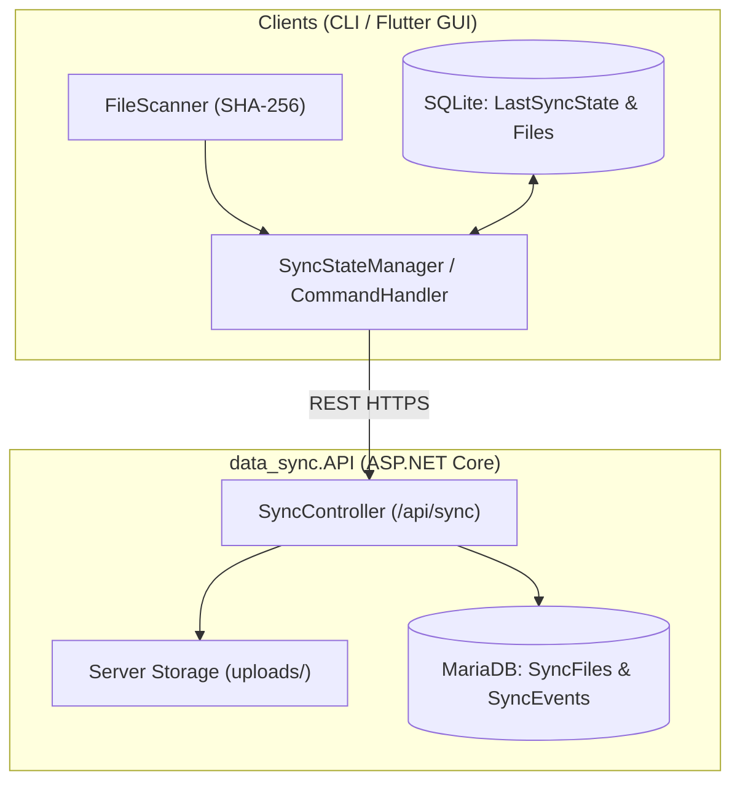
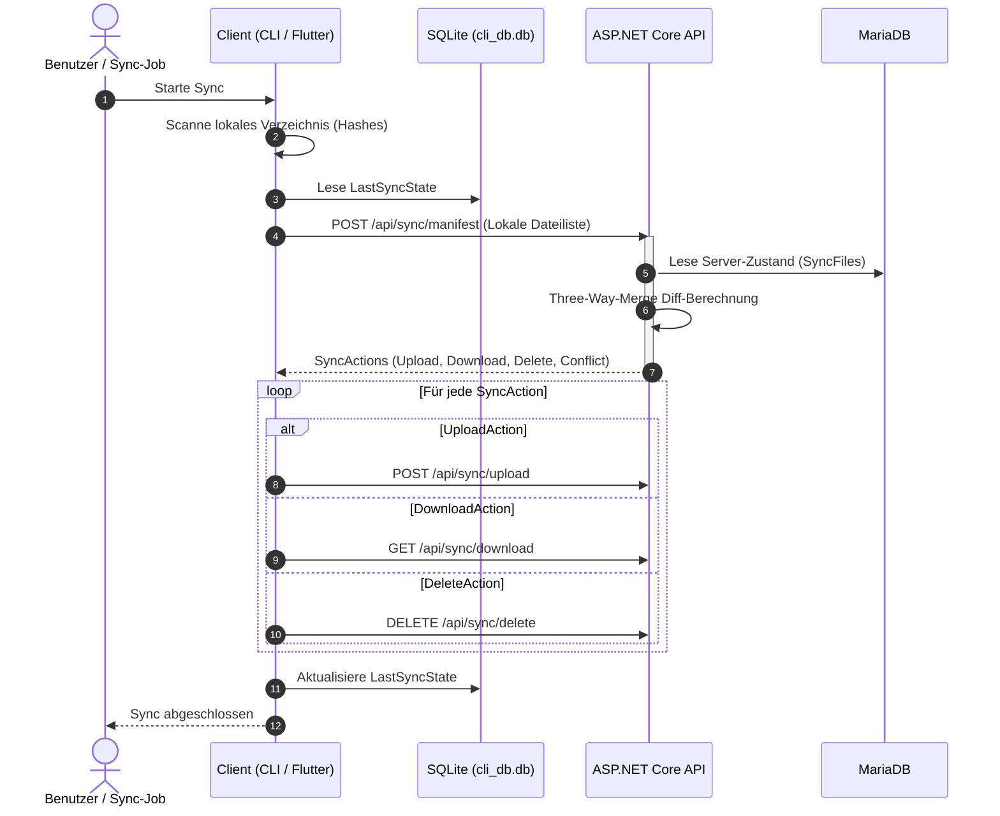
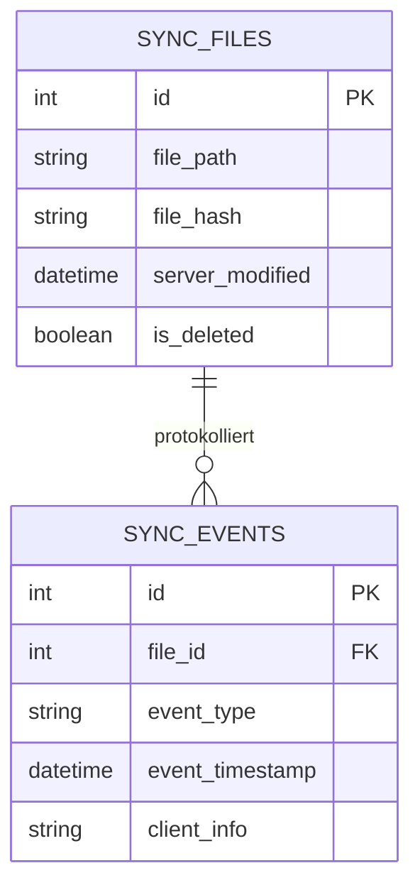

# SKILL: Technische Architektur-Dokumentation & Mermaid-UML (`tech-docs`)

> **Rolle & Einsatzzweck:**
> Dieser Skill standardisiert die Erstellung und Pflege der technischen Entwickler-Dokumentation für `data_sync` unter `Docs/` sowie des chronologischen Projekt-Journals (`Docs/JOURNAL.md`) mit reichhaltigen, direkt in Markdown gerenderten Architektur- und UML-Diagrammen.

---

## 1. Ausgabeformat, Struktur & Datenschutz

- **Format:** Reines GitHub-Flavored Markdown (GFM) auf **Deutsch** (Code-Bezeichner, Klassennamen und Methoden bleiben auf **Englisch**).
- **Ablageort:** `Docs/` (z. B. `Docs/backend_system_design.md`, `Docs/datenbank_design.md`, `Docs/api_usage.md`) sowie `Docs/JOURNAL.md`.
- **Pflicht-Inhalte:**
  1. **Three-Way-Merge & Client-Server-Architektur:** Visualisierung des Zusammenspiels von Dateisystem, lokaler SQLite (`LastSyncState`) und Server-MariaDB (`SyncFiles`).
  2. **API-Schnittstellen:** Spezifikation von `/api/sync/manifest`, `/api/sync/upload`, `/api/sync/download` und `/api/sync/delete`.
  3. **Puffer-Konzepte:** Einhaltung der Namenskonventionen (`sBuffy` für String-Puffer, `iBuffy` für Integer-/Zähler-Puffer).
  4. **Strikter Datenschutz (Public-Repo-Konformität):** Keine absoluten Entwickler-Systempfade (`/home/...` oder `C:\Users\...`). Ausschließlich Komponenten- und relative Pfade.

---

## 2. Verbindliche Architektur- & UML-Diagramme (Mermaid.js)

### A) Client-Server- & Schichtenarchitektur (`flowchart TD`)


### B) Sequenzdiagramm für den Synchronisations-Ablauf (`sequenceDiagram`)


### C) Datenmodell / Entity-Relationship-Diagramm (`erDiagram`)


---

## 3. Lückenlose Pflege des Projekt-Journals (`Docs/JOURNAL.md`)

Jeder abgeschlossene Entwicklungsschritt wird chronologisch **ganz oben** in `Docs/JOURNAL.md` nach folgendem Schema ergänzt:

```markdown
## [YYYY-MM-DD HH:MM] – [Kurztitel des Meilensteins / Features]
- **Durchgeführte Änderungen:** [Präzise Beschreibung der umgesetzten Komponenten]
- **Architekturentscheidungen (Warum):** [Fachliche und technische Begründung]
- **Verifikation:** `[Tests PASSED | Whitelist/Security PASSED | Docs UPDATED]`
- **Offene Punkte / Nächste Schritte:** [To-Dos für die Folgesitzung]
```
