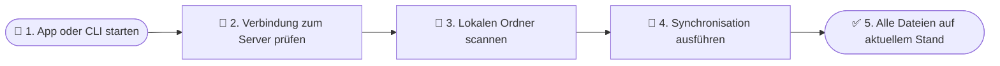
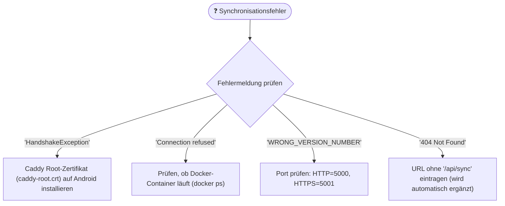

# SKILL: Endbenutzer-Handbuch & Troubleshooting-Guides (`user-docs`)

> **Rolle & Einsatzzweck:**
> Dieser Skill standardisiert die Erstellung und Aktualisierung der Endanwender-Dokumentation für `data_sync` (`Docs/cli_usage.md`, `Docs/flutter_setup.md`, `Docs/server_setup.md` sowie Gesamthandbücher).

---

## 1. Inhaltliche Struktur der Benutzerdokumentation

1. **Systemüberblick:** Was leistet `data_sync`? (Sichere Synchronisation von Dateien, z. B. Obsidian-Vaults, zwischen Windows, Linux und Android).
2. **Server-Einrichtung:** Schnellstart mit Docker Compose und Caddy (Ports 5000 HTTP / 5001 HTTPS).
3. **Client-Bedienung:**
   - **CLI-Client:** Befehle `init`, `scan`, `manifest`, `upload`, `download`, `delete`.
   - **Flutter-App:** Auswahl des lokalen Sync-Ordners, Eingabe der Server-URL, Zertifikatsinstallation (`caddy-root.crt` auf Android) und Ein-Klick-Synchronisation.
4. **Fehlerbehebung & FAQ:** Typische Verbindungsprobleme (`HandshakeException`, Portkonflikte, DNS/Routing im Heimnetz).

---

## 2. Verbindliche Diagramme für das Benutzerhandbuch

### A) Benutzer-Workflow (User Journey)

### B) Troubleshooting-Entscheidungsbaum

---

## 3. Strikte Offline-Fähigkeit & Datenschutz

- **Keine externen Web-CDNs:** Alle Diagramme und Formatierungen werden lokal gerendert (Mermaid in Markdown).
- **Datenschutz:** Keine Entwickler-Pfade (`/home/...`) oder Passwörter in Beispielen abbilden.
