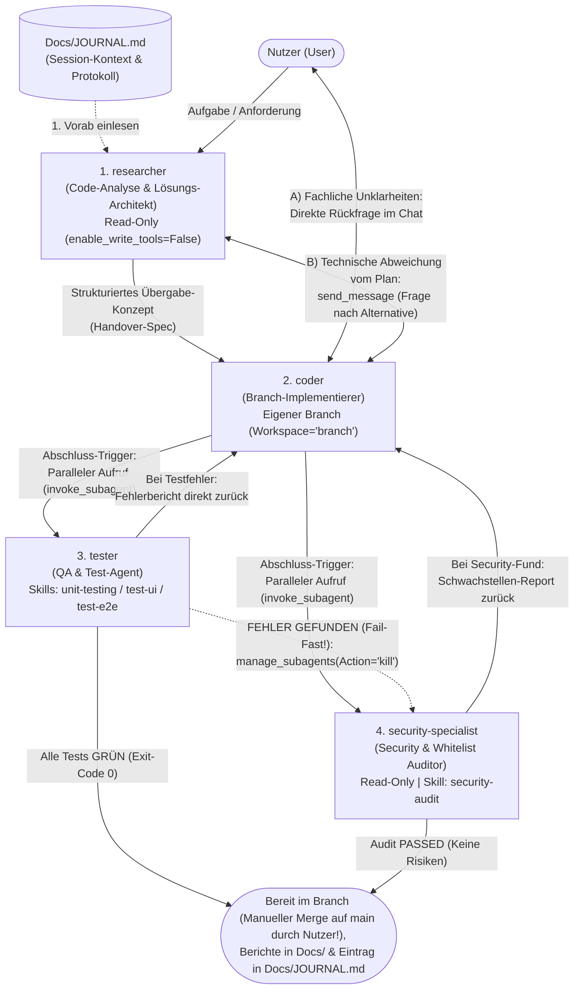

# AGENTS.md - Universelle Projektrichtlinien & Multi-Agenten-Harness für Antigravity

> **Projektname:** `data_sync`  
> **Projektziel / Kernfunktion:** Plattformübergreifendes Dateisynchronisations-System (Cross-Platform Data Sync, u. a. für Obsidian-Notizen) zwischen Windows, Linux (Manjaro) und Android über einen zentralen Server mittels Three-Way-Merge-Manifestabgleich und SHA-256-Hashing.  
> **Tech-Stack & Architektur:** C# ASP.NET Core 10.0 Web API (Backend mit MariaDB via ADO.NET), Python 3 (CLI-Client mit SQLite `cli_db.db`), Flutter / Dart (GUI-Client mit SQLite `sqflite`), Docker & Caddy (Reverse Proxy / HTTPS).  
> **Lizenz:** GPL-3.0 (GNU General Public License v3.0)  
> **Freigegebene externe Bibliotheken (Whitelist):** Ausschließlich die im Projekt genutzten Pakete: `Microsoft.Data.Sqlite`, `MySql.Data`, `DotNetEnv`, `xunit` (Backend); `requests` (CLI); `cupertino_icons`, `sqflite`, `sqflite_common_ffi`, `path_provider`, `path`, `file_picker`, `http`, `crypto`, `google_fonts`, `permission_handler`, `flutter_lints`, `flutter_launcher_icons`, `flutter_test` (Flutter). **Strikte No-New-Libs-Regel: Keine neuen Bibliotheken ohne ausdrückliche Freigabe!**  
> **Test-Befehle:**  
> - Backend: `dotnet test data_sync.API/data_sync.API.csproj`  
> - CLI: `python3 -m unittest discover -s data_sync.CLI/src -v`  
> - Flutter: `cd data_sync.FLUTTER && flutter test`  
> **Lint- & Format-Befehle:**  
> - Backend: `dotnet format data_sync.API/data_sync.API.csproj --verify-no-changes`  
> - CLI: `ruff check data_sync.CLI/src/ || flake8 data_sync.CLI/src/`  
> - Flutter: `dart analyze data_sync.FLUTTER/lib/ data_sync.FLUTTER/test/`

---

## 1. Projektziel, Architektur & Phasen-Modell

### 1.1 Fachlicher Zweck
Das Projekt `data_sync` löst die zuverlässige, selbstgehostete Synchronisation lokaler Verzeichnisse (insbesondere von Obsidian-Vaults) über mehrere Betriebssysteme (Linux, Windows, Android) hinweg.
Die Datenintegrität wird über SHA-256-Prüfsummen, Pfadnormalisierung und einen serverseitigen Three-Way-Merge gewährleistet.

### 1.2 Entwicklungs-Phasen
- **Phase 1 (Abgeschlossen):** Planung, Datenbankdesign (MariaDB & SQLite) und Implementierung der ASP.NET Core REST API (`0.0.1` – `0.0.2`).
- **Phase 2 (Abgeschlossen):** Vollständiger Python-CLI-Client (`data_sync.CLI`) inkl. Three-Way-Merge, Duplikaterkennung, Pfad-Normalisierung und bidirektionalem Löschen (`0.0.3`).
- **Phase 3 (Aktuell – In Arbeit):** Plattformübergreifende GUI-App mit Flutter (`data_sync.FLUTTER`) für Android, Linux und Windows inkl. lokaler SQLite-Anbindung und REST-Sync (`0.0.4`).
- **Phase 4 (Zukunft – Testing & Release):** End-to-End-Tests, automatisiertes Deployment, sichere Credential-Speicherung und Release `1.0.0` (`0.1.0` – `1.0.0`).

### 1.3 Architektur- & Sync-Workflow (ASCII-Übersicht)
```text
╭──────────────────────────────╮         HTTPS / REST          ╭──────────────────────────────╮
│   Client (CLI / Flutter)     │ ────────────────────────────► │   Backend (ASP.NET Core)     │
│                              │   1. POST /api/sync/manifest  │                              │
│  ┌────────────────────────┐  │ ◄──────────────────────────── │  ┌────────────────────────┐  │
│  │ Lokales Sync-Dir       │  │   2. Liste: SyncActions       │  │ Server Storage         │  │
│  │ (SHA-256 File Scanner) │  │      (Upload/Download/Delete) │  │ (uploads/...)          │  │
│  └───────────┬────────────┘  │                               │  └───────────▲────────────┘  │
│              ▼               │   3. GET  /api/sync/download  │              │               │
│  ┌────────────────────────┐  │   4. POST /api/sync/upload    │  ┌───────────┴────────────┐  │
│  │ SQLite (cli_db.db)     │  │   5. DEL  /api/sync/delete    │  │ MariaDB                │  │
│  │ - Files                │  │ ────────────────────────────► │  │ - SyncFiles            │  │
│  │ - LastSyncState        │  │                               │  │ - SyncEvents / Logs    │  │
│  └────────────────────────┘  │                               │  └────────────────────────┘  │
╰──────────────────────────────╯                               ╰──────────────────────────────╯
```

### 1.4 Verzeichnisstruktur des Projekts
```text
data_sync/
├── data_sync.API/              # ASP.NET Core 10.0 Web API (C#)
│   ├── Controllers/            # REST-Endpunkte (/api/sync/manifest, upload, download, delete)
│   ├── Services/               # MariaDBService (ADO.NET), FileStorageService, SyncLogic
│   ├── Models/                 # DTOs & Entitäten (SyncManifest, SyncAction)
│   ├── Tests/                  # xUnit Tests & Testdaten
│   └── compose.yaml            # Docker-Setup (API, MariaDB, Caddy)
├── data_sync.CLI/              # Python CLI-Client
│   ├── src/                    # CLI-Einstiegspunkt, Scanner, Commands & DB-Handler
│   ├── cli_db.db               # Lokale SQLite-Datenbank
│   └── config.json             # Lokale Client-Konfiguration
├── data_sync.FLUTTER/          # Plattformübergreifende Flutter-GUI (Android/Linux/Windows)
│   ├── lib/                    # Flutter UI & Business Logic
│   ├── test/                   # Widget- und Unit-Tests
│   └── pubspec.yaml            # Flutter-Abhängigkeiten
├── Docs/                       # Entwicklungs- & Benutzerdokumentation
│   ├── JOURNAL.md              # Chronologisches Entwicklungs- & Entscheidungsprotokoll
│   ├── unit_test_report.md     # Unit-Testbericht
│   └── security_audit_report.md# Verbindlicher Security- & Whitelist-Auditbericht
├── .agents/
│   └── skills/                 # Progressive Disclosure Spezial-Skills
│       ├── code-quality-linting/
│       ├── code-refactoring/
│       ├── database-migration/
│       ├── gitignore-analyzer/
│       ├── security-audit/
│       ├── tech-docs/
│       ├── test-e2e/
│       ├── test-ui/
│       ├── unit-testing/
│       └── user-docs/
├── AGENTS.md                   # Universelle Agenten-Regeln (diese Datei)
├── GEMINI.md                   # Hierarchische Workspace-Regeln für Antigravity
└── README.md                   # Projektdokumentation
```

---

## 2. Bibliotheken & Abhängigkeiten (Strikte Whitelist-Richtlinie)

- **Standardbibliotheken:** Alle mitgelieferten Standardmodule (.NET Base Class Library, Python Standardbibliothek wie `os`, `sys`, `hashlib`, `sqlite3`, `json`, `argparse`, `pathlib`, `typing`, `math` sowie das Flutter/Dart SDK) dürfen jederzeit frei und ohne Rückfrage eingesetzt werden.
- **Freigegebene externe Bibliotheken (Whitelist):** Ausschließlich die folgenden externen Pakete sind für die Implementierung zugelassen:
  - **Backend (`data_sync.API` – C# / .NET 10.0):**
    - `MySql.Data` *(direkter ADO.NET-Zugriff auf MariaDB – **kein** ORM / EF Core)*
    - `DotNetEnv`
    - `xunit`
  - **CLI-Client (`data_sync.CLI` – Python):**
    - `requests`
  - **GUI-Client (`data_sync.FLUTTER` – Flutter / Dart):**
    - `cupertino_icons`
    - `sqflite` & `sqflite_common_ffi`
    - `path_provider` & `path`
    - `file_picker`
    - `http`
    - `crypto`
    - `google_fonts`
    - `permission_handler`
    - `flutter_lints` & `flutter_launcher_icons` *(Dev-Dependencies)*
    - `flutter_test` *(SDK)*
- **Verbot anderer externer Bibliotheken (KEINE NEUEN LIBRARIES):** Alle weiteren Drittanbieter-Pakete (insbesondere ORMs wie Entity Framework Core) sind standardmäßig **strikt untersagt**. Externe Abhängigkeiten sind nach Möglichkeit immer zu vermeiden.
- **Genehmigungspflicht:** Sollte ein zusätzliches externes Paket zwingend erforderlich sein, muss vor der Installation oder Verwendung zwingend beim Nutzer nachgefragt und eine nachvollziehbare Begründung geliefert werden.

---

## 3. Core Agent Harness (Verbindliche Leitplanken & No-Gos)

### 3.1 Plan-Act-Verify Protokoll & Autonome Arbeitsweise
1. **Session-Start (`Docs/JOURNAL.md` lesen):** Lies zu Beginn jeder neuen Sitzung oder vor der Bearbeitung neuer Aufgaben **zuerst `Docs/JOURNAL.md`** ein, um den aktuellen Projektstand, vergangene Architekturentscheidungen und offene Punkte zu erfassen.
2. **PLAN (Analysieren & Entwerfen):** Vor jeder Codeänderung Anforderungen, bestehende Architektur und Abhängigkeiten prüfen. Bei fachlichen Unklarheiten Rückfragen stellen, statt Annahmen zu treffen.
3. **ACT (Durchgängig & Isoliert umsetzen):** Logisch aufeinanderfolgende Schritte (Planen ➔ Implementieren im Branch ➔ Tests ausführen ➔ Fehler beheben ➔ Dokumentieren) sind selbstständig, proaktiv und am Stück durchzuführen.
4. **VERIFY (Test-Zwang & Security-Gate):** Nach jedem implementierten Schritt ist zwingend der passende Test (`dotnet test`, Python-CLI-Tests, `flutter test`) sowie das QA- und Security-Gate auszuführen. Kein Schritt gilt als abgeschlossen, bevor nicht alle Tests grün sind.
5. **JOURNAL-Pflicht (`Docs/JOURNAL.md` fortschreiben):** Jeder abgeschlossene Schritt, jede Architekturentscheidung und jede Änderung ist verbindlich und **chronologisch oben in `Docs/JOURNAL.md`** zu dokumentieren.

### 3.2 Harte Grenzen (Absolute No-Gos)
- **Keine Tests löschen, abschwächen oder deaktivieren:** Bestehende Tests dürfen niemals gelöscht, mit Skips übergangen oder in ihren Assertions aufgeweicht werden, um einen Build künstlich „grün" zu färben.
- **Keine Secrets oder Zugangsdaten im Code:** API-Keys, Passwörter, Login-Daten, Tokens oder Verbindungs-URLs mit Credentials dürfen niemals im Quellcode oder in Version-Control-Dateien hinterlegt werden. Nutze ausschließlich Umgebungsvariablen und `.env.example`-Vorlagen.
- **Keine ungefragten Paketinstallationen oder Downloads:** Es dürfen keine nicht auf der Whitelist stehenden Pakete installiert (`dotnet add package`, `pip install`, `flutter pub add`) werden.
- **Kein Entity Framework Core / ORM:** Der Datenbankzugriff auf MariaDB erfolgt ausschließlich über direktes SQL mit ADO.NET (`MySql.Data`).
- **Kein automatischer Merge auf `main`:** Commits dürfen ausschließlich im jeweiligen Feature-/Arbeits-Branch erfolgen. Ein Merge auf den `main`-Branch darf **niemals** durch einen Agenten ausgeführt werden, sondern erfolgt **immer manuell durch den Nutzer**.

---

## 4. Programmier-, Namens-, Git- & Clean-Code-Konventionen

- **Englische Bezeichner:** Klassen (`PascalCase`), Methoden/Funktionen (`camelCase` in C#/Dart, `snake_case` in Python) und Variablen werden grundsätzlich auf **Englisch** benannt.
- **Buffer- und Zählvariablen-Konvention (`sBuffy` / `iBuffy` – Verbindlich):**
  - Temporäre Puffer, Zwischenspeicher und Schleifenzähler **müssen zwingend** mit dem entsprechenden Datentyp-Präfix gekennzeichnet werden:
    - **String-Puffer / Text-Zwischenspeicher:** `sBuffy` (oder `sBuffer...`, z. B. `sBufferPath`, `sBufferHash`)
    - **Integer-Puffer / Zählvariablen:** `iBuffy` (oder `iBuffer...`, z. B. `iBufferCount`, `iBufferIndex`)
  - Diese Konvention (`sBuffy` / `iBuffy`) ist verbindlich für Zwischenspeicherungen und Zählschleifen im gesamten Projektcode und in Prüfskripten zu verwenden.
- **Deutsche Kommentare & Docstrings:** Sämtliche Code-Kommentare, Modul-Header, XML-Docs (`///`) und Docstrings werden ausschließlich auf **Deutsch** verfasst.
- **Fokus auf das fachliche *Warum*:** Kommentare sind kurz, präzise und ausgewogen zu halten – sie erklären den fachlichen Sinn und Architekturentscheidungen (*Warum* wird etwas getan?), nicht triviale Sprach-Grundlagen.
- **Git-Branches & Deutsche Commit-Nachrichten (Verbindlich):**
  - Alle **Git-Commit-Nachrichten auf Deutsch** verfassen und folgendes Präfix-Schema einhalten:
    - `feat: <Deutsche Beschreibung des neuen Features>`
    - `bugfix: <Deutsche Beschreibung des behobenen Fehlers>`
    - `refactor: <Deutsche Beschreibung des Code-Umbaus>`
    - `docs: <Deutsche Beschreibung der Dokumentations-Änderung>`
    - `test: <Deutsche Beschreibung der neuen oder angepassten Tests>`
    - `chore: <Deutsche Beschreibung sonstiger Wartungsarbeiten>`
  - Wenn auf einem extra Branch gearbeitet wird, wird **ausschließlich im neuen Arbeits-Branch committed**. Ein Merge auf den `main`-Branch erfolgt **niemals automatisch durch den Agenten**, sondern immer **manuell durch den Nutzer** (GitLab Flow).
- **Clean Code & OOP (SOLID & SRP):**
  - Single Responsibility Principle (SRP): Kurze, modulare Klassen und Methoden.
  - Kapselung, explizite Typisierung und keine Magic Numbers.

---

## 5. Workspace-, Ausführungs- & Datenschutz-Richtlinien

### 5.1 Workspace- & Ausführungs-Richtlinie
- **Freie Befehlsausführung im Projektverzeichnis:** Innerhalb des Projektverzeichnisses (`data_sync`) dürfen Dateien, Verzeichnisse und Prüf-/Testbefehle (`dotnet`, `python`, `pytest`, `flutter`, `dart`, `git status` etc.) frei und eigenständig ausgeführt werden.
- **Strikte Rückfragepflicht außerhalb des Workspaces:** Eine vorherige Rückfrage beim Nutzer ist zwingend erforderlich, sobald Aktionen außerhalb des Projektverzeichnisses stattfinden sollen.
- **Lokale Artefakt-Ablage (`Docs/`):** Projektdokumentationen, Architekturpläne, das `JOURNAL.md` sowie Test- und Security-Berichte (`Docs/*_report.md`) werden sauber im Projektverzeichnis unter `Docs/` abgelegt.

### 5.2 Berichts- & Dokumentations-Datenschutz (Public-Repo-Konformität)
- **Keine persönlichen Entwickler-Systempfade in öffentlichen Berichten:** In allen generierten Test- und Security-Audit-Berichten (`Docs/*_report.md`) sowie in öffentlicher Dokumentation dürfen **keine persönlichen absoluten Dateisystempfade des Entwicklers** (wie `/home/<benutzername>/...` oder `C:\Users\<benutzername>\...`) oder lokale OS-Benutzernamen enthalten sein.
- Verwende in Berichten stattdessen **sprechende Komponenten-/Modulnamen** (z. B. `SyncController`, `MariaDBService`, `SqliteHandler`, `FileScanner`, `ApiClient`) oder **projektrelative Pfade** (`data_sync.API/...`), sodass Berichte bedenkenlos in ein öffentliches Git-Repository eingecheckt werden können.

---

## 6. Verbindlicher Multi-Agenten-Workflow & Spezialisten-Rollen

Für alle Features, Bugfixes und Refactorings ist in Antigravity der folgende **4-Agenten-Workflow** verbindlich einzuhalten.

### 6.1 Architektur- & Ablaufdiagramm



### 6.2 Rollen-Definitionen

#### Rolle 1: `researcher` (Code-Analyse & Lösungs-Architekt)
- **Berechtigungen:** Strikter Read-Only-Modus (`enable_write_tools=False`).
- **Aufgaben:**
  - Liest `Docs/JOURNAL.md` sowie Quellcode, prüft Bibliotheken gegen die Whitelist und konzipiert saubere Lösungen.
  - Erstellt ein strukturiertes Übergabe-Konzept (Handover-Spec) für den `coder`-Agenten (betroffene Module, Signaturen inkl. `sBuffy`/`iBuffy`-Konvention, Randfälle, Tests).

#### Rolle 2: `coder` (Branch-Implementierer)
- **Arbeitsbereich & Git-Disziplin:** Übernimmt das Übergabe-Konzept und erstellt einen eigenen Branch (`Workspace="branch"`). Committet ausschließlich im neuen Branch mit deutschen Commit-Nachrichten (`feat: ...`, `bugfix: ...`). Kein automatischer Merge auf `main`!
- **Kommunikation:** Fachliche Rückfragen an den Nutzer; bei technischen Plan-Abweichungen Rückfrage per `send_message` an den `researcher`.
- **Abschluss-Trigger:** Startet nach Fertigstellung parallel `tester` und `security-specialist`.

#### Rolle 3: `tester` (QA & Test-Agent)
- **Grundlage:** Führt Tests über `.agents/skills/unit-testing/SKILL.md` (sowie `test-ui` und `test-e2e`) aus.
- **Fail-Fast-Regel (KRITISCH):** Stellt der `tester` einen Fehler fest, bricht er den parallel laufenden `security-specialist` sofort ab (`manage_subagents(Action="kill")`) und spielt den Fehler an den `coder` zurück.

#### Rolle 4: `security-specialist` (Security & Whitelist Auditor)
- **Berechtigungen:** Strikter Read-Only-Modus (`enable_write_tools=False`).
- **Aufgaben:** Führt `.agents/skills/security-audit/scripts/check_downloads.py` aus, prüft die Whitelist (KEINE NEUEN LIBRARIES!), scannt auf Secrets, Path Traversal und SQL-Injection und erstellt `Docs/security_audit_report.md`. Wird sofort terminiert, wenn `tester` einen Fehler meldet.

---

## 7. Definition of Done (Abschlusskriterien)
Eine Aufgabe gilt erst dann als vollständig abgeschlossen, wenn:
1. Das Konzept im isolierten Branch umgesetzt wurde.
2. Linting und Formatierung fehlerfrei durchlaufen.
3. Der `tester`-Agent bestätigt, dass alle Tests mit Exit-Code 0 bestehen (`Docs/unit_test_report.md`).
4. Der `security-specialist`-Agent das Audit mit Status `PASSED` abgeschlossen hat (`Docs/security_audit_report.md`).
5. Alle Änderungen und Entscheidungen chronologisch oben in `Docs/JOURNAL.md` dokumentiert wurden.
